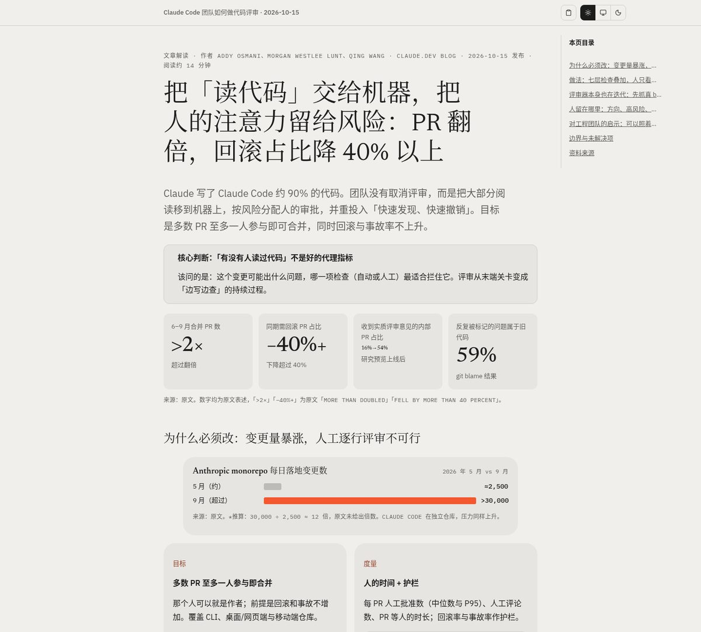
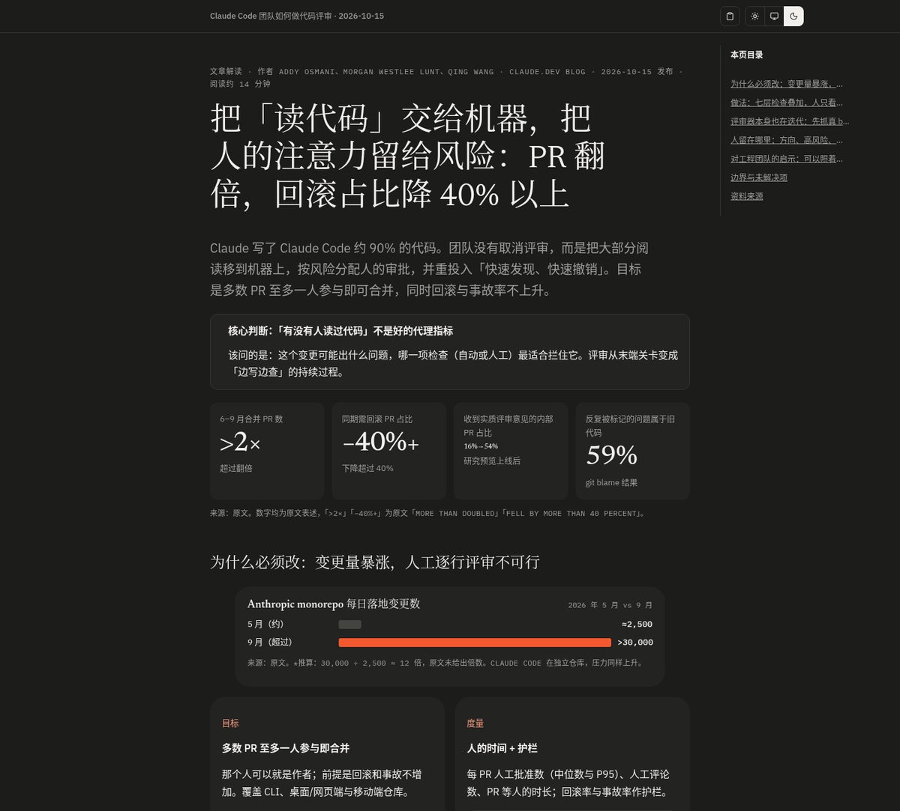
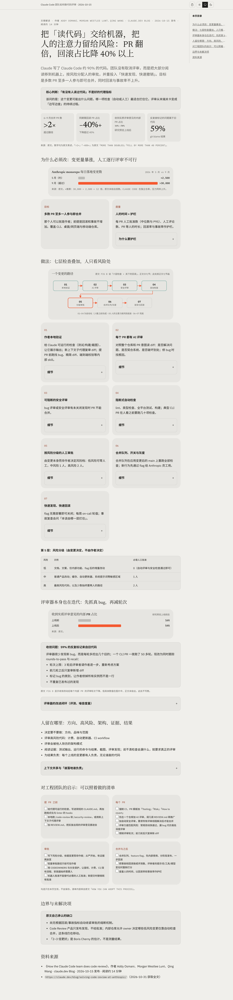
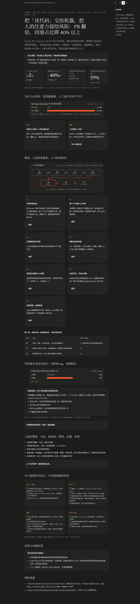

<div align="center">

# show-me-html

**An agent skill that turns long write-ups, reports, and research into polished, single-file HTML pages.**

English · [简体中文](README.zh-CN.md)

[](LICENSE)


</div>

---

`show-me-html` is built on [hi-zhenyu/show-me-html](https://github.com/hi-zhenyu/show-me-html). It keeps the original skill's rules and references, and adds a ready-to-use visual base — `assets/skeleton.html` — so every generated page shares one consistent, shareable look with no external dependencies beyond optional, asynchronously loaded web fonts.

## ✨ Highlights

| | Feature | Details |
|---|---|---|
| 📄 | **Single self-contained file** | Inline CSS and JS. Send one `.html`, it just opens. |
| 🌗 | **Light / dark / system theme** | Three-state switch in the top bar; choice is remembered in `localStorage`. Printing always uses the light palette. |
| 🧭 | **Auto table of contents** | Built from the page headings, shown as a side panel on wide screens. |
| ↕️ | **Sortable tables** | Add `class="sortable"` to a `<table>`; click or press Enter on a header. Understands `1,200`, `30%`, `12×`, and sorts Chinese with `localeCompare`. |
| 📋 | **Copy as Markdown** | One click exports the page content to Markdown on the clipboard. |
| 🧩 | **Code block toolbar** | Wrap / copy buttons on every `pre > code`. |
| 🔽 | **Details collapsed by default** | Conclusions and key numbers stay visible; reasoning, evidence, and logs go into closed `<details>`. |
| 🔤 | **Async web fonts, offline fallback** | Google Fonts (IBM Plex, Newsreader, Noto Serif SC) load asynchronously without blocking first paint; offline, `--font-serif`, `--font-sans`, `--font-mono` fall back to system fonts. |

## 🖼️ Preview

A report generated with this skill, in both themes:

| Light | Dark |
|---|---|
|  |  |

<details>
<summary><b>Click to expand the full-page preview</b></summary>

<p align="center">
  
  
</p>

</details>

Want to see the base itself? Open [`assets/skeleton.html`](assets/skeleton.html) directly in a browser. For a finished page, see [`assets/example-claude-code-review.html`](assets/example-claude-code-review.html) — a sample report on how the Claude Code team does code review (the screenshots above are taken from it).

## 📦 Install

### Recommended: `npx skills`

Install with the [vercel-labs/skills](https://github.com/vercel-labs/skills) CLI (requires Node.js 22.20+):

```bash
npx skills add iMeiji/show-me-html        # install into the current project
npx skills add iMeiji/show-me-html -g     # install globally
```

Pick the target agent(s) with `-a` / `--agent`, repeat it for several agents:

```bash
npx skills add iMeiji/show-me-html -a claude-code            # Claude Code only
npx skills add iMeiji/show-me-html -a codex                  # Codex only
npx skills add iMeiji/show-me-html -a claude-code -a codex   # several agents
npx skills add iMeiji/show-me-html -g -a claude-code -y      # global + non-interactive
npx skills add iMeiji/show-me-html --agent '*'               # every supported agent
```

Without `-a`, the CLI detects the agents installed on your machine and lets you choose. Common agent names:

| Agent | `--agent` | Global path (`-g`) |
|-------|-----------|--------------------|
| Claude Code | `claude-code` | `~/.claude/skills/` |
| Codex | `codex` | `~/.agents/skills/` |
| Cursor | `cursor` | `~/.cursor/skills/` |
| Gemini CLI | `gemini-cli` | `~/.gemini/skills/` |
| GitHub Copilot | `github-copilot` | `~/.copilot/skills/` |
| OpenCode | `opencode` | `~/.config/opencode/skills/` |
| Windsurf | `windsurf` | `~/.codeium/windsurf/skills/` |

See the full list in the [supported agents](https://github.com/vercel-labs/skills/blob/main/docs/agents.md) doc. By default the CLI keeps one copy and symlinks it into each agent's folder; add `--copy` to copy files instead.

Manage it later with `npx skills list`, `npx skills update`, and `npx skills remove`. The CLI collects anonymous usage data; set `DISABLE_TELEMETRY=1` to opt out.

### Alternative: manual install

Copy the whole folder into your skills directory:

```bash
git clone https://github.com/iMeiji/show-me-html.git
mkdir -p ~/.agents/skills
cp -R show-me-html ~/.agents/skills/show-me-html
```

Then start a new session. Agent tools that support the `SKILL.md` skill format (for example Claude Code or Cursor) can pick it up from their skills folder — check your tool's docs for the exact path it scans.

## 🚀 Usage

Just ask for an HTML artifact; the skill decides when HTML beats Markdown. Example prompts:

- "Use show-me-html to turn this research into a report."
- "Make this incident write-up an HTML page I can share with the team."
- "Compare these three options side by side as an HTML page, with a sortable table."
- "用 show-me-html 把这份调研整理成报告"

<details>
<summary><b>What the skill does under the hood</b></summary>

1. Locks a short brief: purpose, audience, content shape, visual direction, interactions, chart strategy.
2. Reads only the relevant files in `references/`.
3. Starts from `assets/skeleton.html` and replaces only `<main id="doc">`, `<title>`, and `.chrome-title` — the page structure still follows the content, not a fixed template.
4. Marks missing values as `[DATA NEEDED: ...]` and labels any derived numbers.
5. Self-reviews against `references/interface-quality.md`, optionally with headless Chrome screenshots in both themes.
6. Saves as `<slug>-YYYY-MM-DD.html` (generation date).

</details>

## 🗂️ Project structure

```text
show-me-html/
├── SKILL.md                    # Skill entry: rules, workflow, local additions (Chinese)
├── assets/
│   ├── skeleton.html           # Visual base: CSS, theme / TOC / sort / copy scripts
│   └── example-claude-code-review.html  # Sample output (not a template)
├── references/                 # Unchanged from upstream
│   ├── interactive-tools.md
│   ├── interface-quality.md
│   ├── math-and-data.md
│   ├── patterns.md
│   └── visual-direction.md
├── docs/images/                # README screenshots
├── README.md
├── README.zh-CN.md
├── NOTICE
└── LICENSE
```

## 🙏 Credits

Based on **[hi-zhenyu/show-me-html](https://github.com/hi-zhenyu/show-me-html)** by Zhenyu Huang (MIT). What this project changes:

- `SKILL.md`: original text kept as-is; `name` changed, and a short Chinese "local additions" section appended (default visual base, async web fonts with offline fallback, no fabricated data, details collapsed, redaction, sortable tables, screenshot self-check).
- Added `assets/skeleton.html`: the CSS visual system and shell scripts come from a page generated by show-me-html; Google Fonts async loading is kept, with system font stacks as the offline fallback, and a native sortable-table script was added.
- `references/`: unchanged.

See [NOTICE](NOTICE) for details.

## 📄 License

[MIT](LICENSE). The original copyright of Zhenyu Huang is retained.
