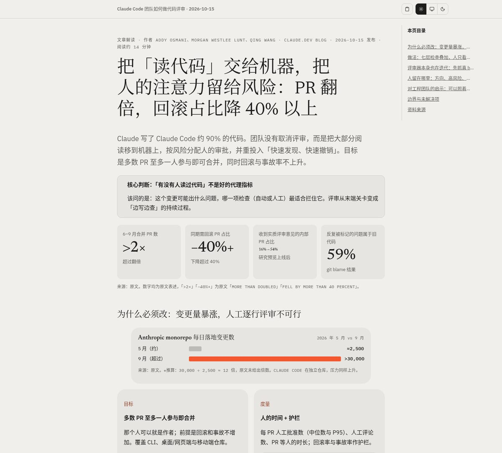
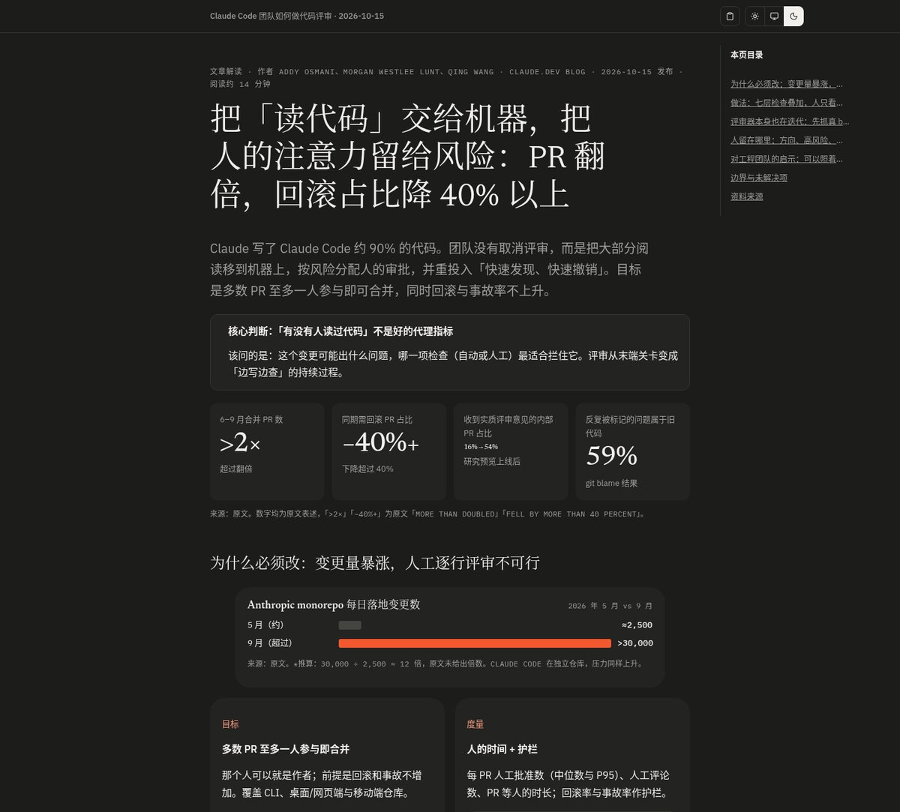
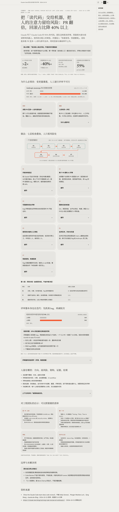
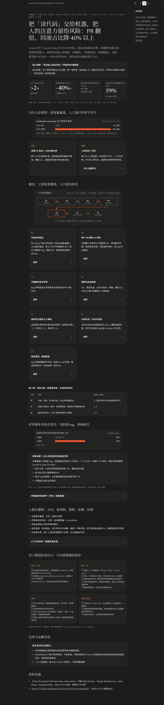

<div align="center">

# show-me-html

**把长文、报告、调研整理成精致单文件 HTML 页面的 Agent Skill。**

[English](README.md) · 简体中文

[](LICENSE)


</div>

---

`show-me-html` 基于 [hi-zhenyu/show-me-html](https://github.com/hi-zhenyu/show-me-html)，保留原版的规则和参考文档，并加入一套开箱即用的视觉底板 `assets/skeleton.html`，让每次生成的页面风格统一、便于分享，除可选的异步网络字体外没有外部依赖。

## ✨ 功能亮点

| | 功能 | 说明 |
|---|---|---|
| 📄 | **单文件自包含** | CSS、JS 全部内联，发一个 `.html` 就能打开。 |
| 🌗 | **亮 / 暗 / 跟随系统** | 顶栏三态切换，选择记在 `localStorage`；打印时始终用亮色。 |
| 🧭 | **自动目录** | 按页面标题生成，宽屏显示在侧栏。 |
| ↕️ | **可排序表格** | 给 `<table>` 加 `class="sortable"`，点击或回车切换升降序；识别 `1,200`、`30%`、`12×`，中文用 `localeCompare` 排序。 |
| 📋 | **复制为 Markdown** | 一键把页面内容导出为 Markdown 到剪贴板。 |
| 🧩 | **代码块工具条** | 每个 `pre > code` 自带换行、复制按钮。 |
| 🔽 | **细节默认收起** | 结论和关键数字保持可见；原因链、证据、日志放进默认收起的 `<details>`。 |
| 🔤 | **异步网络字体，离线回退** | 异步加载 Google Fonts（IBM Plex、Newsreader、Noto Serif SC），不阻塞首屏；离线时 `--font-serif`、`--font-sans`、`--font-mono` 回退到本机系统字体。 |

## 🖼️ 效果预览

用本 skill 生成的一份报告，亮暗两种主题：

| 亮色 | 暗色 |
|---|---|
|  |  |

<details>
<summary><b>点击展开整页预览</b></summary>

<p align="center">
  
  
</p>

</details>

想看底板本身？直接用浏览器打开 [`assets/skeleton.html`](assets/skeleton.html)。成品效果见 [`assets/example-claude-code-review.html`](assets/example-claude-code-review.html)，是一份解读 Claude Code 团队代码评审做法的示例报告，上面的截图就取自它。

## 📦 安装

### 推荐：`npx skills`

用 [vercel-labs/skills](https://github.com/vercel-labs/skills) 命令行工具安装（需要 Node.js 22.20+）：

```bash
npx skills add iMeiji/show-me-html        # 装到当前项目
npx skills add iMeiji/show-me-html -g     # 全局安装
```

用 `-a` / `--agent` 指定要装给哪个 agent，装给多个就重复写：

```bash
npx skills add iMeiji/show-me-html -a claude-code            # 只装给 Claude Code
npx skills add iMeiji/show-me-html -a codex                  # 只装给 Codex
npx skills add iMeiji/show-me-html -a claude-code -a codex   # 同时装给多个
npx skills add iMeiji/show-me-html -g -a claude-code -y      # 全局安装 + 跳过确认
npx skills add iMeiji/show-me-html --agent '*'               # 装给所有支持的 agent
```

不写 `-a` 时，工具会检测本机已安装的 agent，让你勾选。常用 agent 名称：

| Agent | `--agent` | 全局路径（`-g`） |
|-------|-----------|------------------|
| Claude Code | `claude-code` | `~/.claude/skills/` |
| Codex | `codex` | `~/.agents/skills/` |
| Cursor | `cursor` | `~/.cursor/skills/` |
| Gemini CLI | `gemini-cli` | `~/.gemini/skills/` |
| GitHub Copilot | `github-copilot` | `~/.copilot/skills/` |
| OpenCode | `opencode` | `~/.config/opencode/skills/` |
| Windsurf | `windsurf` | `~/.codeium/windsurf/skills/` |

完整列表见[支持的 agent](https://github.com/vercel-labs/skills/blob/main/docs/agents.md)。默认只保留一份文件，再用软链接分发到各 agent 目录；加 `--copy` 则改为复制。

之后可用 `npx skills list`、`npx skills update`、`npx skills remove` 管理。该工具会收集匿名使用数据，设置 `DISABLE_TELEMETRY=1` 即可关闭。

### 备选：手动安装

把整个目录复制到 skills 目录：

```bash
git clone https://github.com/iMeiji/show-me-html.git
mkdir -p ~/.agents/skills
cp -R show-me-html ~/.agents/skills/show-me-html
```

然后开一个新会话。支持 `SKILL.md` 格式的 Agent 工具（如 Claude Code、Cursor）会从各自的 skills 目录识别它，具体扫描路径以各工具文档为准。

## 🚀 使用

直接让 Agent 出 HTML 即可，skill 会自己判断什么时候 HTML 比 Markdown 更合适。提示词示例：

- 「用 show-me-html 把这份调研整理成报告」
- 「把这次故障说明做成能发给团队的 HTML 页面」
- 「把这三个方案做成并排对比的 HTML，带可排序表格」
- "Use show-me-html to turn this research into a report."

<details>
<summary><b>skill 内部做了什么</b></summary>

1. 先定简要 brief：目的、读者、内容形态、视觉方向、交互、图表策略。
2. 只读取 `references/` 里用得到的文件。
3. 以 `assets/skeleton.html` 为底，只替换 `<main id="doc">`、`<title>` 和 `.chrome-title`，页面结构仍按内容来定，不套固定模板。
4. 缺失数据写 `[DATA NEEDED: ...]`，推算出的数字注明算法。
5. 对照 `references/interface-quality.md` 自检，可用无头 Chrome 截亮暗两张图检查。

</details>

## 🗂️ 项目结构

```text
show-me-html/
├── SKILL.md                    # Skill 入口：规则、流程、中文本地补充说明
├── assets/
│   ├── skeleton.html           # 视觉底板：CSS，主题 / 目录 / 排序 / 复制脚本
│   └── example-claude-code-review.html  # 示例成品（不是模板）
├── references/                 # 与上游一致，未修改
│   ├── interactive-tools.md
│   ├── interface-quality.md
│   ├── math-and-data.md
│   ├── patterns.md
│   └── visual-direction.md
├── docs/images/                # README 截图
├── README.md
├── README.zh-CN.md
├── NOTICE
└── LICENSE
```

## 🙏 致谢与来源

基于 Zhenyu Huang 的 **[hi-zhenyu/show-me-html](https://github.com/hi-zhenyu/show-me-html)**（MIT）。本项目的改动：

- `SKILL.md`：原版正文原样保留，改了 `name`，末尾追加简短的中文「本地补充说明」（默认视觉底板、异步网络字体与离线回退、不编造数据、细节默认收起、脱敏、可排序表格、截图自检）。
- 新增 `assets/skeleton.html`：视觉系统 CSS 和 shell 脚本取自 show-me-html 生成的页面，保留 Google Fonts 异步加载、以系统字体栈作离线回退，并加入原生可排序表格脚本。
- `references/`：未修改。

详见 [NOTICE](NOTICE)。

## 📄 License

[MIT](LICENSE)，保留原作者 Zhenyu Huang 的版权声明。
